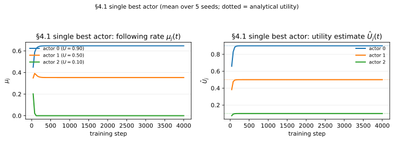
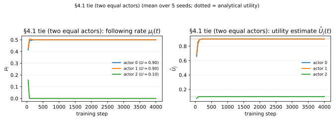
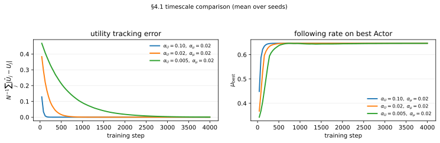
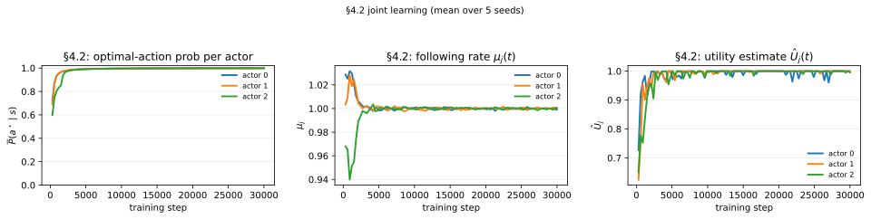

# Paper §4 — Imperfect Reward, Perfect State (One Observer, Many Actors)

This report documents Sections 4.1 and 4.2 of the supplementary paper. Each
case states the **mechanism under test**, uses a controlled setup whose correct
answer is known in advance, plots the **internal learnable variable** that the
mechanism is supposed to move, and verifies that it moves in the expected
direction. Reward is reported as supporting evidence, not as the only proof.

## Track and mechanism

This case belongs to the **imperfect-reward / perfect-state** track: every Actor
sees the state perfectly, but reward is *Observer-mediated and intermittent*. A
single Observer watches `N` Actors and must decide whom to spend its limited
evaluative attention on.

The newly introduced learnable object is the **budgeted following-rate vector**

```
μ = (μ_1, …, μ_N),   μ_j ≥ 0,   Σ_j μ_j ≤ B.
```

`μ_j` is how strongly the Observer follows Actor `j`. It controls the
probability that the Observer actually reports the reward it saw:

```
θ(μ_j) = 1 − e^{−c·μ_j},      c > 0.
```

Supporting internal quantities:

- `Û_j` — running estimate of Actor `j`'s average reward (Eq. 9), updated on a
  **fast** timescale;
- `μ_j` — updated by **projected gradient ascent** on a **slow** timescale.

**The tracked variables for this case are `μ_j(t)` and `Û_j(t)`.** "Reward
went up" is not the claim; "the Observer reallocates attention toward the
genuinely higher-utility Actors" is the claim.

## Setup conventions

| Quantity                | Value / encoding                                                            |
| ----------------------- | --------------------------------------------------------------------------- |
| State count             | controlled tests use **1 state** (so per-Actor utility is known analytically) |
| Action count            | 3                                                                           |
| State encoding          | one-hot vector (`IIDStateBanditEnv`)                                        |
| State distribution      | deterministic single state for §4.1 tests; uniform 3-state for §4.2         |
| Actor selection         | one Actor `j_t ~ p` acts per step; `p` uniform                              |
| Reward source           | **hard-coded** reward table `R(s,a)` (no learned reward)                     |
| What the Actor observes | the full one-hot state                                                      |
| What the Observer sees  | the realized reward `R(s_t, a_t)` of the acting Actor                       |
| §4.1 Actor policies     | **fixed** sharpness-8 softmax, Actor `j` ≈ always picks action `j`          |
| §4.2 Actor policies     | **learnable** one-layer `SoftmaxPolicy` (linear logits, no hidden layer)    |
| Learnable in §4.1       | only the Observer's `μ` and `Û`                                             |
| Learnable in §4.2       | Observer's `μ`, `Û`, **and** each Actor's policy `θ_j`                       |
| Expected change         | `μ` concentrates on high-`Û` Actors; `Û` converges to analytical utilities  |

Math → code map:

| Symbol / equation                                       | Code                                                                  |
| ------------------------------------------------------- | --------------------------------------------------------------------- |
| `μ` on capped simplex `{μ≥0, Σμ≤B}`                     | `BudgetedObserver.mu` + `project_capped_simplex`                      |
| `θ(μ) = 1 − e^{−cμ}`                                    | `BudgetedObserver.report_probabilities`                              |
| `θ'(μ) = c·e^{−cμ}`                                     | `BudgetedObserver.report_derivative`                                 |
| Bernoulli report `Bernoulli(θ(μ_j))`                    | `BudgetedObserver.should_report`                                     |
| `Û ← Û + α_U(r − Û)` (active actor only, Eq. 9)         | `BudgetedObserver.update_utility`                                    |
| `μ ← μ + α_μ·θ'(μ)·Û` then project (Eq. 11–12)          | `BudgetedObserver.update_following_rates`                            |
| Actor selection `j_t ~ p`                               | `MultiActorTrainer._sample_actor_index` (independent rng stream)     |
| §4.2 REINFORCE on reported step                         | `MultiActorTrainer.run`                                              |
| Two-timescale `α_U ≫ α_μ`                               | hyperparameters (see each experiment below)                          |

All figures below are generated by
`uv run python experiments/run_paper_4_figures.py` (mean over 5 seeds).

---

## §4.1 — Observer learns whom to follow (fixed Actor policies)

### Mechanism under test

Only the Observer learns. Given fixed Actors with known utilities, does
projected gradient ascent push the limited budget `B` onto the best Actors?

### Controlled test 1: one strictly-best Actor (known answer)

Single state, 3 fixed Actors, reward row `R = [0.9, 0.5, 0.1]`. Each fixed
Actor uses a sharp softmax centered on its target action, so the analytical
utilities round to `U = [0.9, 0.5, 0.1]`. Budget `B = 1`, `c = 2`,
`α_U = 0.10`, `α_μ = 0.02` (slow following-rate timescale). 4000 steps.

**Expected behavior:** `Û → [0.9, 0.5, 0.1]`; `μ` concentrates on Actor 0, the
useless Actor 2 drops to `μ_2 ≈ 0`, and the budget binds (`Σμ = 1`).



Result (mean over 5 seeds):

```
expected_U  = 0.900 | 0.500 | 0.100
final_Uhat  = 0.900 | 0.500 | 0.100   (utility estimates match the targets)
final_mu    = 0.647 | 0.353 | 0.000   (sum = 1.000, budget binds)
```

The left panel shows `μ_j(t)`: Actor 0 climbs, Actor 2 collapses to zero within
~200 steps. The right panel shows `Û_j(t)` snapping onto the dotted analytical
utility lines. This is the direct mechanism-level verification: the internal
variable moves toward the known-correct allocation, ordered by true utility
(`μ_0 > μ_1 > μ_2`).

### Controlled test 2: tie (two equally good Actors)

Same setup but `R = [0.9, 0.9, 0.1]`, so Actors 0 and 1 are equally useful and
Actor 2 is useless.

**Expected behavior:** budget should split between the tied optimal Actors while
the useless Actor still loses all attention. Whether the split is perfectly even
or seed-dependent is not the point — the point is that mass leaves the
low-utility Actor.



Result (mean over 5 seeds):

```
expected_U  = 0.900 | 0.900 | 0.100
final_Uhat  = 0.900 | 0.900 | 0.100
final_mu    = 0.500 | 0.500 | 0.000   (sum = 1.000)
```

The two tied Actors share the budget symmetrically and Actor 2 → 0. Because the
two top Actors are genuinely symmetric here, the across-seed mean is also the
per-seed behavior (no hidden collapse); the symmetry is exact rather than an
averaging artifact.

### §4.1 takeaway

The following-rate mechanism is verified at the level of its internal variable:
`Û` recovers the true utilities and `μ` is steered onto the high-utility set
under the budget constraint, in both the strict-best and tie regimes.

### Additional timescale check

The main §4.1 runs use a fast utility estimate and a slower following-rate
update. To make this visible, we also run the single-best controlled setup while
holding `α_μ = 0.02` fixed and varying `α_U`.



The left panel shows mean utility-tracking error
`N^{-1} Σ_j |Û_j - U_j|`; the right panel shows the following rate on the
best Actor. Larger `α_U` makes the utility estimates accurate before the
following rates have moved far. Equal or smaller `α_U` still converges in this
simple fixed-Actor setting, but the utility estimates lag and the following-rate
movement is slower. This supports the intended two-timescale discipline:
estimate utility quickly, then move the budgeted following rates more
conservatively.

---

## §4.2 — Actors and Observer learn jointly

### Mechanism under test

Now each Actor also has a learnable policy. A reported step
(`Bernoulli(θ(μ_j))` succeeds) drives a REINFORCE update
`θ_j ← θ_j + α_θ · r · ∇log π_{θ_j}`. We check that (a) every Actor learns its
state-optimal action, and (b) the Observer's `μ`/`Û` remain consistent.

### Setup

3 states (uniform), 3 actions, 3 Actors. Reward table
`R = [[1.0, 0.1, 0.2], [0.1, 1.0, 0.0], [0.0, 0.2, 1.0]]`, optimal actions
`[0, 1, 2]`. Budget `B = 3`, `c = 2` (so initial `μ = [1,1,1]` gives
`θ ≈ 0.865`, high-throughput reporting), `α_U = 0.20`, `α_μ = 0.01`,
`α_θ = 0.20`. 30000 steps.

**Expected behavior:** each Actor's optimal-action probability rises toward 1;
`Û_j → 1` (per-actor ceiling); since all Actors become equally good and the
budget is large enough to fund everyone, `μ → [1, 1, 1]` is the correct
symmetric fixed point.



Result (mean over 5 seeds):

```
final_optimal_prob = 0.999 | 0.999 | 0.999
final_mu           = 0.999 | 1.001 | 1.000   (sum = 3.000)
```

Left panel: all three per-Actor optimal-action probabilities climb to ≈ 0.999.
Middle panel: `μ_j(t)` stays near the symmetric `[1,1,1]` allocation (correct,
since the budget can fully fund all three improving Actors). Right panel:
`Û_j(t)` rises toward the per-Actor ceiling of 1.0 as the policies improve.

### §4.2 takeaway

Joint learning is stable under the two-timescale discipline (`α_U ≫ α_μ`): the
fast utility estimate tracks the improving Actors, and the slow following-rate
update keeps `μ` feasible (`Σμ = B`) throughout. The figures show the mechanism:
policies improve, utilities rise, and attention stays feasible, not only that
final reward is high.

---

## Implementation notes

- **Independent sampling streams (bug fixed).** `_sample_actor_index` and the
  environment state sampler both draw from `torch.multinomial` over uniform
  3-way distributions. Seeding both generators from the same user seed produced
  perfectly correlated index sequences (`actor_index == state_index` every
  step), so each Actor only ever saw one state and §4.2 appeared not to learn.
  The trainer now derives per-stream seeds via
  `_stream_seed(seed, "actor_selection")` and `_stream_seed(seed, "env_state")`
  (SHA-256 offsets), keeping the streams independent yet reproducible. See
  `src/actor_observer_rl/training/multi_actor.py`.
- **Reporting semantics.** We implement intermittent reporting as a Bernoulli
  gate `Bernoulli(θ(μ_j))` plus a standard REINFORCE update on accepted steps.
  The alternative reading (deterministic update scaled by `θ(μ_j)` every active
  step) is available by removing the gate and multiplying `reward` by
  `observer.report_probability(j)`.
- **Why controlled single-state tests for §4.1.** Using one state makes each
  fixed Actor's utility analytically exact (`U_j = R[0][j]`), which is what lets
  the `Û` plot be checked against ground-truth dotted lines. This is the
  "design a toy case where the expected outcome is known" principle applied to
  the following-rate mechanism.

## Reproduce

```bash
uv run python experiments/run_paper_4_1.py          # §4.1 default headline run
uv run python experiments/run_paper_4_2.py          # §4.2 default headline run
uv run python experiments/run_paper_4_figures.py      # regenerate all §4 figures
uv run pytest tests/test_budgeted_observer.py tests/test_multi_actor_training.py
```
