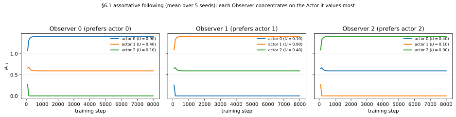
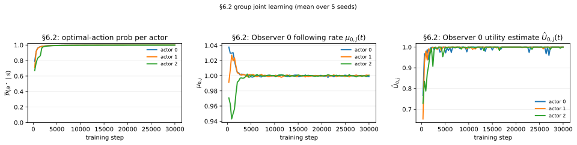

# Paper §6 — Imperfect Reward, Perfect State (Many Observers, Many Actors)

This report documents Sections 6.1 and 6.2 of the supplementary paper. It is the
**group-level** generalization of §4: instead of a single Observer watching `N`
Actors, there are now `N` Observers, each with its **own** reward function `R_i`
and its **own** budgeted following-rate vector `μ_i`. As in the §4 report, each
case states the mechanism under test, uses a controlled setup whose correct
answer is known in advance, plots the internal learnable variable, and verifies
it moves in the expected direction.

## Track and mechanism

This case belongs to the **imperfect-reward / perfect-state** track: every Actor
sees the state perfectly, but reward is *Observer-mediated and intermittent*. The
group setting adds **heterogeneous Observers**:

- `N` Actors `A_1, …, A_N`, one acting per step (`j_t ~ p`).
- `N` Observers `O_1, …, O_N`. When Actor `j_t` acts, Observer `i` perceives its
  *own* reward `R_i(s_t, a_t)`. Because the `R_i` differ, two Observers can value
  the same Actor differently.

Each Observer holds the §4 machinery independently:

```
μ_i = (μ_{i,1}, …, μ_{i,N}),   μ_{i,j} ≥ 0,   Σ_j μ_{i,j} ≤ B,
θ(μ_{i,j}) = 1 − e^{−c·μ_{i,j}},
Û_{i,j}  — running estimate of R_i for Actor j (Eq. 27), fast timescale,
μ_i      — projected gradient ascent, slow timescale (same algorithm as §4.1).
```

**The tracked variables for this case are `μ_{i,j}(t)` and `Û_{i,j}(t)`.** The
group-level claim is: *each Observer reallocates its attention toward the Actors
that are genuinely higher-utility under its own reward function*, and (in §6.2)
*Actors improve under the Observer-aggregated reward signal*.

## Setup conventions

| Quantity                | Value / encoding                                                              |
| ----------------------- | ----------------------------------------------------------------------------- |
| Observer count          | 3 (each with a private reward table `R_i`)                                    |
| Actor count             | 3                                                                             |
| State count             | §6.1 controlled test uses **1 state** (per-Actor utility known analytically); §6.2 uses uniform 3-state |
| Action count            | 3                                                                             |
| State encoding          | one-hot vector (`IIDStateBanditEnv`, used only for state sampling)            |
| Actor selection         | one Actor `j_t ~ p` acts per step; `p` uniform                                |
| Reward source           | **hard-coded** per-Observer reward tables `R_i(s,a)`                          |
| What each Observer sees  | its own realized reward `R_i(s_t, a_t)` of the acting Actor                  |
| §6.1 Actor policies     | **fixed** sharpness-8 softmax, Actor `j` ≈ always picks action `j`            |
| §6.2 Actor policies     | **learnable** one-layer `SoftmaxPolicy`                                       |
| Learnable in §6.1       | each Observer's `μ_i` and `Û_i`                                               |
| Learnable in §6.2       | every `μ_i`, `Û_i`, **and** each Actor's policy `θ_j`                         |

Math → code map:

| Symbol / equation                                            | Code                                                              |
| ------------------------------------------------------------ | ----------------------------------------------------------------- |
| `μ_i` on capped simplex `{μ≥0, Σμ≤B}`                        | `BudgetedObserver.mu` + `project_capped_simplex` (one per Observer) |
| `Û_{i,j_t} ← Û + α_U(r_i − Û)` (active actor only, Eq. 27)   | `BudgetedObserver.update_utility`                                |
| `μ_i ← μ_i + α_μ·θ'(μ_i)·Û_i` then project (same as §4.1)    | `BudgetedObserver.update_following_rates`                        |
| Per-Observer reward `R_i(s_t, a_t)`                          | `GroupMultiActorTrainer.observer_reward_tables`                 |
| §6.2 aggregate `r_eff(j) = Σ_i θ(μ_{i,j})·R_i(s,a)` (Eq. 29) | `GroupMultiActorTrainer._aggregate_reward`                      |
| §6.2 REINFORCE on aggregate                                  | `GroupMultiActorTrainer.run`                                    |
| Actor selection `j_t ~ p`                                    | `GroupMultiActorTrainer._sample_actor_index` (independent rng)  |
| Two-timescale `α_U ≫ α_μ`                                    | hyperparameters (see each experiment)                           |

All figures below are generated by
`uv run python experiments/run_paper_6_figures.py` (mean over 5 seeds).

---

## §6.1 — Observers learn whom to follow (fixed Actor policies)

### Mechanism under test

Only the Observers learn. Given fixed Actors and **heterogeneous** reward
functions, does each Observer's projected gradient ascent push its budget onto
the Actors *it* values most?

### Controlled test: assortative reward (known answer)

Single state, 3 fixed Actors (Actor `j` ≈ action `j`), 3 Observers with diagonal
reward tables:

```
R_0 = [0.9, 0.4, 0.1]   → Observer 0 most values Actor 0
R_1 = [0.1, 0.9, 0.4]   → Observer 1 most values Actor 1
R_2 = [0.4, 0.1, 0.9]   → Observer 2 most values Actor 2
```

Budget `B = 2`, `c = 1`, `α_U = 0.10`, `α_μ = 0.05`. 8000 steps.

**Expected behavior:** Observer `i`'s utility estimate peaks at Actor `i`, and
its following rate concentrates on Actor `i`. The constrained optimum of
`max Σ_j θ(μ_{i,j}) Û_{i,j}` s.t. `Σ_j μ_{i,j} ≤ B` is reached when the
highest-utility Actor receives the most budget and the worst Actor drops to 0.
For `Û = [0.9, 0.4, 0.1]`, the KKT solution is `μ = [1.405, 0.595, 0]`.



Result (mean over 5 seeds):

```
[Observer 0] final_mu = 1.405 | 0.595 | 0.000   (prefers actor 0, argmax(mu)=0)
[Observer 1] final_mu = 0.000 | 1.405 | 0.595   (prefers actor 1, argmax(mu)=1)
[Observer 2] final_mu = 0.595 | 0.000 | 1.405   (prefers actor 2, argmax(mu)=2)
```

The empirical following rates land exactly on the analytical KKT allocation, and
each Observer specializes toward a different Actor. This is the group-level
mechanism verification: with private reward functions, attention self-organizes
into an **assortative** pattern rather than collapsing onto one globally "best"
Actor.

### §6.1 takeaway

Running `N` independent budgeted Observers over a shared Actor pool reproduces
the §4.1 following-rate mechanism per Observer, and heterogeneous reward
functions yield differentiated, utility-ordered attention allocations.

---

## §6.2 — Actors and Observers learn jointly

### Mechanism under test

Each Actor now has a learnable policy. Per Eq. (29), Actor `j`'s effective reward
aggregates over Observers, weighted by each Observer's reporting probability:

```
r_eff(j) = Σ_i θ(μ_{i,j}) · R_i(s_t, a_t),
θ_j ← θ_j + α_θ · r_eff(j) · ∇ log π_{θ_j}(a_t | s_t).
```

We check that (a) every Actor learns its state-optimal action under the
aggregated signal, and (b) the Observers' `μ_i`/`Û_i` remain feasible and
consistent.

### Setup

3 states (uniform), 3 actions, 3 Actors, 3 Observers sharing the diagonal reward
table `R = [[1.0, 0.1, 0.2], [0.1, 1.0, 0.0], [0.0, 0.2, 1.0]]`, optimal actions
`[0, 1, 2]`. Budget `B = 3`, `c = 2`, `α_U = 0.20`, `α_μ = 0.01`, `α_θ = 0.10`.
30000–40000 steps.

**Expected behavior:** each Actor's optimal-action probability rises toward 1;
each `Û_{i,j} → 1` as policies improve. Because all Actors converge to the same
optimal behavior, they become equally valuable to every Observer, so each `μ_i`
settles at the symmetric `[1, 1, 1]` allocation — the correct "no reason to
prefer any Actor" fixed point.



Result (mean over 5 seeds):

```
final_optimal_prob = 0.999 | 0.999 | 0.999
[Observer i] final_mu = 1.000 | 1.000 | 1.000   (sum = 3.000, for every i)
```

Left panel: all three per-Actor optimal-action probabilities climb to ≈ 0.999
under the aggregated reward. Middle panel: Observer 0's `μ_{0,j}(t)` stays near
the symmetric allocation. Right panel: Observer 0's `Û_{0,j}(t)` rises toward the
per-Actor ceiling of 1.0. The other Observers behave identically here because
they share the reward table.

### §6.2 takeaway

Joint group learning is stable under the two-timescale discipline. The
Observer-aggregated reward `Σ_i θ(μ_{i,j}) R_i` is a well-behaved training signal
for the Actors, and every Observer's budget stays feasible (`Σ_j μ_{i,j} = B`)
throughout.

---

## Implementation notes

- **Eq. (29) aggregation is deterministic.** §6.2 multiplies each Observer's
  reward by its current reporting probability `θ(μ_{i,j})` and sums, rather than
  drawing a Bernoulli report per Observer. This matches the formula in Eq. (29)
  literally and lowers variance in the group setting. (The §4.2 Bernoulli-gated
  variant remains available there.)
- **Per-Observer reward functions.** The group novelty over §4 is that reward is
  private to each Observer (`R_i`), which is what makes the assortative §6.1
  result possible. Reward tables are supplied as a `[observer][state][action]`
  array via `GroupMultiActorTrainer.observer_reward_tables`.
- **Independent sampling streams.** As in §4, actor selection and environment
  state sampling use independent `_stream_seed` offsets so the two streams are
  decoupled yet reproducible.
- **Why a single-state controlled §6.1 test.** One state makes each fixed Actor's
  per-Observer utility analytically exact (`U_{i,j} = R_i[0][j]`), so the final
  `μ_i` can be checked against the closed-form KKT allocation.

## Reproduce

```bash
uv run python experiments/run_paper_6_1.py          # §6.1 default headline run
uv run python experiments/run_paper_6_2.py          # §6.2 default headline run
uv run python experiments/run_paper_6_figures.py    # regenerate all §6 figures
uv run pytest tests/test_group_multi_actor.py
```
